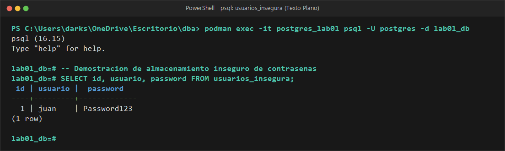
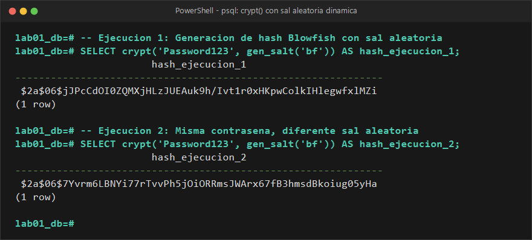
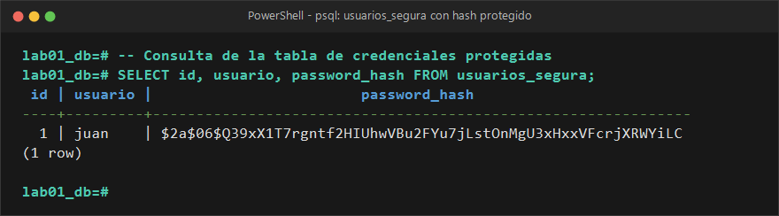
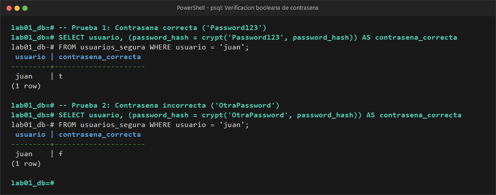

# EVIDENCIA 01: PROTECCIÓN DE CREDENCIALES

* **Materia:** Gestión de Seguridad y Desempeño de Bases de Datos  
* **Unidad:** II. Seguridad, privacidad y control de acceso  
* **Tema:** 2.4 Cifrado, credenciales y protección de las comunicaciones  
* **Motor:** PostgreSQL 16  
* **Estudiante:** Genaro Isaac Cárdenas Soto (@darksitoV)  
* **Organización / Escenario:** Comercializadora Norte S.A. de C.V.  

---

## 1. Objetivo
Demostrar las vulnerabilidades inherentes al almacenamiento de contraseñas en texto claro dentro de una base de datos, implementar mecanismos de protección criptográfica mediante funciones de derivación de claves unidireccionales con sal (`gen_salt` y `crypt` del módulo `pgcrypto`), y verificar el proceso seguro de autenticación sin requerir la recuperación de la contraseña original.

---

## 2. Comando o Procedimiento Realizado

### Paso 2.1 — Demostración del almacenamiento inseguro en texto plano
Se creó la tabla `usuarios_insegura` y se insertó una credencial en claro para evidenciar la vulnerabilidad:

```sql
CREATE EXTENSION IF NOT EXISTS pgcrypto;

DROP TABLE IF EXISTS usuarios_insegura;
CREATE TABLE usuarios_insegura (
    id BIGSERIAL PRIMARY KEY,
    usuario VARCHAR(50) NOT NULL,
    password VARCHAR(100) NOT NULL
);

INSERT INTO usuarios_insegura (usuario, password)
VALUES ('juan', 'Password123');

SELECT id, usuario, password FROM usuarios_insegura;
```

### Paso 2.2 — Generación de hash no reversible con salt dinámico
Se probó la función `crypt()` combinada con `gen_salt('bf')` (algoritmo Blowfish / bcrypt) ejecutada en dos ocasiones consecutivas sobre la misma contraseña:

```sql
-- Ejecución 1
SELECT crypt('Password123', gen_salt('bf')) AS hash_ejecucion_1;

-- Ejecución 2
SELECT crypt('Password123', gen_salt('bf')) AS hash_ejecucion_2;
```

### Paso 2.3 — Creación de la tabla segura y registro protegido
Se implementó la tabla `usuarios_segura` utilizando una columna de tipo `TEXT` para almacenar el hash con sal y se insertó la credencial protegida:

```sql
DROP TABLE IF EXISTS usuarios_segura;
CREATE TABLE usuarios_segura (
    id BIGSERIAL PRIMARY KEY,
    usuario VARCHAR(50) UNIQUE NOT NULL,
    password_hash TEXT NOT NULL
);

INSERT INTO usuarios_segura (usuario, password_hash)
VALUES ('juan', crypt('Password123', gen_salt('bf')));

SELECT id, usuario, password_hash FROM usuarios_segura;
```

### Paso 2.4 — Proceso de verificación y autenticación
Se validó el mecanismo de autenticación comparando el hash almacenado contra el resultado de evaluar una contraseña correcta y una incorrecta:

```sql
-- Validación con contraseña correcta ('Password123')
SELECT usuario, (password_hash = crypt('Password123', password_hash)) AS contraseña_correcta
FROM usuarios_segura 
WHERE usuario = 'juan';

-- Validación con contraseña incorrecta ('OtraPassword')
SELECT usuario, (password_hash = crypt('OtraPassword', password_hash)) AS contraseña_correcta
FROM usuarios_segura 
WHERE usuario = 'juan';
```

---

## 3. Resultado Obtenido

### Salida 3.1: Exposición en texto plano (`usuarios_insegura`)


```text
 id | usuario |  password   
----+---------+-------------
  1 | juan    | Password123
(1 row)
```

### Salida 3.2: Comparación de ejecuciones sucesivas de `crypt()` con `gen_salt('bf')`


```text
                          hash_ejecucion_1                           
---------------------------------------------------------------------
 $2a$06$jJPcCdOI0ZQMXjHLzJUEAuk9h/Ivt1r0xHKpwColkIHlegwfxlMZi
(1 row)

                          hash_ejecucion_2                           
---------------------------------------------------------------------
 $2a$06$7Yvrm6LBNYi77rTvvPh5jOiORRmsJWArx67fB3hmsdBkoiug05yHa
(1 row)
```

### Salida 3.3: Verificación de la tabla protegida (`usuarios_segura`)


```text
 id | usuario |                        password_hash                         
----+---------+--------------------------------------------------------------
  1 | juan    | $2a$06$Q39xX1T7rgntf2HIUhwVBu2FYu7jLstOnMgU3xHxxVFcrjXRWYiLC
(1 row)
```

### Salida 3.4: Resultados de la verificación de contraseña


```text
-- Prueba con contraseña correcta:
 usuario | contrasena_correcta 
---------+---------------------
 juan    | t
(1 row)

-- Prueba con contraseña incorrecta:
 usuario | contrasena_correcta 
---------+---------------------
 juan    | f
(1 row)
```

---

## 4. Análisis y Respuestas a las Preguntas Guía

### 4.1 ¿Qué ocurriría si una persona obtiene acceso de lectura a `usuarios_insegura`?
Si un usuario con privilegios de lectura, un operador interno malintencionado o un atacante externo a través de una vulnerabilidad de Inyección SQL (SQLi) o volcado de respaldo (`pg_dump`) lee la tabla `usuarios_insegura`, **obtiene inmediatamente el secreto en texto plano**. Esto conlleva:
1. **Compromiso inmediato de la cuenta:** El atacante puede autenticarse sin requerir fuerza bruta.
2. **Efecto dominó por reutilización de credenciales:** Frecuentemente los usuarios reutilizan la misma contraseña en correos institucionales, sistemas bancarios o VPNs corporativas.
3. **Responsabilidad regulatoria y legal:** Infracción grave de marcos normativos de protección de datos (LFPDPPP, GDPR, ISO/IEC 27001), al carecer de controles básicos de confidencialidad.

### 4.2 ¿Son iguales los resultados generados en las dos ejecuciones de `crypt()`?
**No, son completamente diferentes.** Aunque la entrada (`'Password123'`) fue exactamente la misma, los valores generados difieren en su totalidad.

### 4.3 ¿Por qué no son iguales y qué función cumple `gen_salt()`?
No son iguales porque `gen_salt('bf')` genera una secuencia aleatoria criptográfica denominada **sal (salt)** cada vez que es invocada. 
* **Función de `gen_salt()`:** Agrega entropía aleatoria a la entrada antes de aplicar el algoritmo matemático.
* **Propósito de seguridad:** Evita que dos usuarios con la misma contraseña tengan el mismo hash almacenado y neutraliza por completo los ataques basados en **tablas precalculadas (Rainbow Tables)**, forzando al atacante a atacar cada credencial de forma individual.

### 4.4 ¿Qué función cumple `crypt()`?
Aplica una función de derivación de claves para contraseñas (en este caso el algoritmo Blowfish/bcrypt) tomando como entrada el texto en claro y la sal. El resultado devuelto encapsula:
* El prefijo identificador del algoritmo (`$2a$`).
* El factor de costo de procesamiento (`06`).
* La sal generada (los primeros 22 caracteres base64).
* El valor del hash calculado propiamente dicho.

### 4.5 ¿Esto es cifrado reversible?
**No. Es un hash criptográfico unidireccional con sal.** No existe una operación matemática inversa que permita tomar `$2a$06$...` y deducir `'Password123'`. La única vía para "adivinarlo" es fuerza bruta o diccionario, lo cual se mitiga incrementando el costo de cómputo del algoritmo.

### 4.6 ¿Por qué no es necesario recuperar la contraseña original para verificarla?
Porque la verificación se basa en el principio de comprobación por evaluación idéntica:
1. Al pasar el hash existente `password_hash` como segundo argumento a `crypt('Password123', password_hash)`, la función extrae automáticamente el salt original que está incrustado en el hash.
2. Calcula el hash de la contraseña ingresada empleando exactamente ese mismo salt e iteraciones.
3. Compara el nuevo hash contra el hash previamente almacenado. Si coinciden, se demuestra que quien introdujo la contraseña conoce el secreto original, **sin necesidad de que el sistema conozca ni almacene jamás la contraseña en texto legible**.

### 4.7 ¿Por qué un hash nunca debe confundirse con cifrado?
| Criterio | Hash / Derivación de Clave | Cifrado (Symmetric / Asymmetric) |
| :--- | :--- | :--- |
| **Direccionalidad** | Unidireccional (One-way). Irreversible. | Bidireccional (Two-way). Reversible mediante clave. |
| **Propósito principal** | Demostrar conocimiento o integridad sin revelar el secreto. | Proteger información confidencial que debe recuperarse posteriormente. |
| **Uso de clave secreta** | Utiliza salt público/aleatorio, no requiere clave de descifrado. | Requiere claves criptográficas para cifrar y descifrar. |
| **Aplicación idónea** | Contraseñas, firmas digitales, verificación de archivos. | RFC, números de tarjeta, expedientes médicos, respaldos. |

---

## 5. Conclusión
El almacenamiento de contraseñas jamás debe realizarse en texto plano ni empleando cifrado simétrico reversible (ya que custodiar la clave del descifrado representaría un punto único de falla catastrófica). 

El uso de funciones de derivación con costo ajustable y sal única (`bcrypt`, `Argon2id`, `PBKDF2`) garantiza que incluso ante una filtración total de la base de datos, las credenciales de los usuarios permanezcan matemáticamente protegidas contra ataques masivos.
