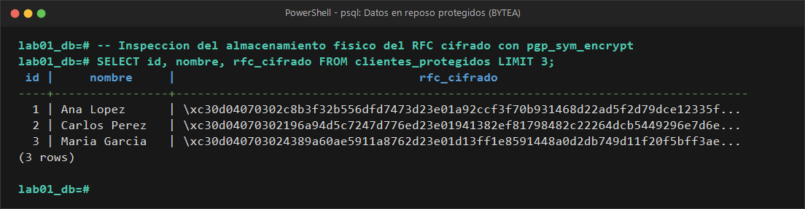
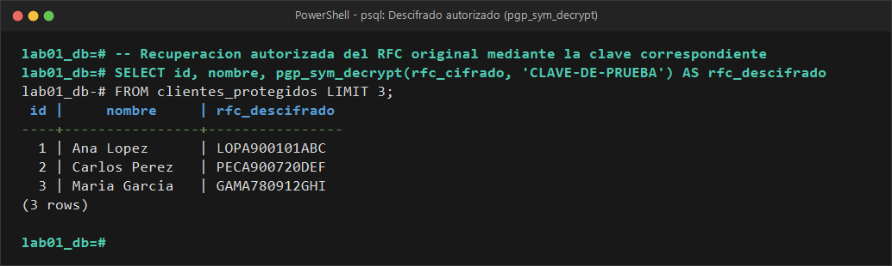
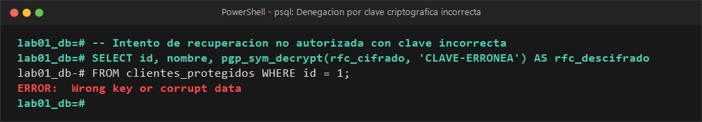

# EVIDENCIA 02: CIFRADO DE INFORMACIÓN SENSIBLE

* **Materia:** Gestión de Seguridad y Desempeño de Bases de Datos  
* **Unidad:** II. Seguridad, privacidad y control de acceso  
* **Tema:** 2.4 Cifrado, credenciales y protección de las comunicaciones  
* **Motor:** PostgreSQL 16  
* **Estudiante:** Genaro Isaac Cárdenas Soto (@darksitoV)  
* **Organización / Escenario:** Comercializadora Norte S.A. de C.V.  

---

## 1. Objetivo
Implementar mecanismos de protección criptográfica simétrica a nivel de columna para datos sensibles que requieren ser recuperados en texto claro bajo condiciones legítimas de negocio (como el Registro Federal de Contribuyentes - RFC), verificar el estado del texto cifrado (`BYTEA`) en reposo, y evaluar el comportamiento del motor ante solicitudes de descifrado autorizadas y no autorizadas.

---

## 2. Comando o Procedimiento Realizado

### Paso 2.1 — Creación de la tabla con columna binaria protegida
Se definió la tabla `clientes_protegidos` con una columna de tipo `BYTEA` destinada a almacenar la salida binaria del cifrado PGP simétrico:

```sql
CREATE EXTENSION IF NOT EXISTS pgcrypto;

DROP TABLE IF EXISTS clientes_protegidos;
CREATE TABLE clientes_protegidos (
    id BIGSERIAL PRIMARY KEY,
    nombre VARCHAR(120) NOT NULL,
    rfc_cifrado BYTEA NOT NULL
);
```

### Paso 2.2 — Inserción de registros mediante cifrado simétrico (`pgp_sym_encrypt`)
Se insertaron datos transformando el RFC plano mediante la función `pgp_sym_encrypt()`, suministrando una clave secreta de prueba:

```sql
INSERT INTO clientes_protegidos (nombre, rfc_cifrado)
VALUES 
    ('Ana López', pgp_sym_encrypt('LOPA900101ABC', 'CLAVE-DE-PRUEBA')),
    ('Carlos Pérez', pgp_sym_encrypt('PECA900720DEF', 'CLAVE-DE-PRUEBA')),
    ('María García', pgp_sym_encrypt('GAMA780912GHI', 'CLAVE-DE-PRUEBA'));
```

### Paso 2.3 — Inspección del dato almacenado en reposo
Se realizó una consulta directa a la tabla para verificar la imposibilidad de interpretar el RFC a simple vista:

```sql
SELECT id, nombre, rfc_cifrado 
FROM clientes_protegidos;
```

### Paso 2.4 — Recuperación autorizada de información (`pgp_sym_decrypt`)
Se ejecutó la consulta de descifrado suministrando la clave correcta autorizada:

```sql
SELECT 
    id, 
    nombre, 
    pgp_sym_decrypt(rfc_cifrado, 'CLAVE-DE-PRUEBA') AS rfc_descifrado
FROM clientes_protegidos;
```

### Paso 2.5 — Prueba de recuperación no autorizada (clave errónea)
Se forzó un intento de descifrado utilizando una clave incorrecta (`'CLAVE-INCORRECTA'`):

```sql
SELECT 
    id, 
    nombre, 
    pgp_sym_decrypt(rfc_cifrado, 'CLAVE-INCORRECTA') AS rfc_descifrado
FROM clientes_protegidos
WHERE id = 1;
```

---

## 3. Resultado Obtenido

### Salida 3.1: Almacenamiento en texto cifrado (`BYTEA`)


Al consultar la tabla directamente, el campo `rfc_cifrado` muestra una cadena binaria hexadecimal (formato PGP OpenPGP Message Format):

```text
 id |    nombre    |                                rfc_cifrado                                
----+--------------+---------------------------------------------------------------------------
  1 | Ana López    | \xc30d04070302c8b3f32b556dfd7473d23e01a92ccf3f70b931468d22ad5f2d79dce...
  2 | Carlos Pérez | \xc30d04070302196a94d5c7247d776ed23e01941382ef81798482c22264dcb544929...
  3 | María García | \xc30d040703024389a60ae5911a8762d23e01d13ff1e8591448a0d2db749d11f20f5...
(3 rows)
```

### Salida 3.2: Descifrado exitoso con clave autorizada


```text
 id |    nombre    | rfc_descifrado 
----+--------------+----------------
  1 | Ana López    | LOPA900101ABC
  2 | Carlos Pérez | PECA900720DEF
  3 | María García | GAMA780912GHI
(3 rows)
```

### Salida 3.3: Error al utilizar clave errónea


```text
ERROR:  Wrong key or corrupt data
```

---

## 4. Análisis y Respuestas a las Preguntas Guía

### 4.1 ¿Qué diferencia existe entre `crypt()` y `pgp_sym_encrypt()`?
* **`crypt()` es una función de hash / derivación unidireccional con salt:** Diseñada para comprobar la autenticidad de un valor sin revelar jamás el secreto original. No existe una función complementaria de descifrado.
* **`pgp_sym_encrypt()` es una función de cifrado simétrico bidireccional:** Diseñada para cifrar datos que **sí necesitan ser recuperados en texto claro** por procesos autorizados (facturación electrónica, auditoría contable). Utiliza algoritmos robustos de cifrado por bloques (AES-128/256 o Blowfish) mediante el estándar OpenPGP (RFC 4880).

### 4.2 ¿Cuál de los dos mecanismos permite recuperar el dato original?
**Exclusivamente `pgp_sym_encrypt()`, mediante su función inversa `pgp_sym_decrypt()`.**  
El hash generado por `crypt()` no puede ser revertido matemáticamente; el dato original solo se comprueba mediante coincidencia de hashes, pero nunca se "extrae".

### 4.3 ¿Qué ocurre si se utiliza una clave incorrecta?
PostgreSQL aborta la transacción y genera la excepción criptográfica:
`ERROR: Wrong key or corrupt data`  
Esto ocurre porque la función PGP valida la suma de verificación de integridad (MDC - Modification Detection Code) incrustada en el paquete cifrado. Al no coincidir los bloques generados por la clave errónea con el hash de integridad del texto original, el motor rechaza la operación garantizando que un usuario no autorizado no pueda deducir ni un solo byte del texto original.

### 4.4 ¿Qué problema de seguridad crítico representa colocar la clave directamente en una consulta SQL?
Incrustar una clave criptográfica directamente en la sentencia SQL (`hardcoded secret`) representa una de las vulnerabilidades más severas en administración de bases de datos:
1. **Exposición en registros del motor (`postgresql.log`):** Si está habilitado `log_statement = 'all'` o `log_min_duration_statement`, la clave queda registrada en texto claro en los archivos de log del servidor.
2. **Exposición en vistas de monitoreo (`pg_stat_activity` y `pg_stat_statements`):** Cualquier DBA o usuario con acceso de monitoreo puede consultar las consultas activas o el histórico de ejecuciones y extraer la clave directamente.
3. **Persistencia en el historial del cliente:** Herramientas como `psql` guardan el historial en `.psql_history`, dejando la clave legible para cualquier usuario con acceso al sistema operativo del cliente.
4. **Filtro hacia repositorios y código fuente:** Si la consulta se encapsula en un archivo `.sql` o en el código de backend y se sube a GitLab/GitHub, la clave se difunde a todo el equipo o al público.

---

## 5. Conclusión
El cifrado en reposo a nivel de columna con `pgcrypto` resuelve eficazmente la confidencialidad de datos regulados (como el RFC) ante volcados no autorizados o lecturas directas del disco. 

Sin embargo, el cifrado solo es tan seguro como la custodia de la clave. En un entorno de producción, la clave de descifrado **nunca debe ser suministrada como un literal en la sentencia SQL**, sino gestionada a través de un Bóveda de Secretos externa (KMS / Vault) o administrada en la capa de la aplicación antes de persistir los datos.
