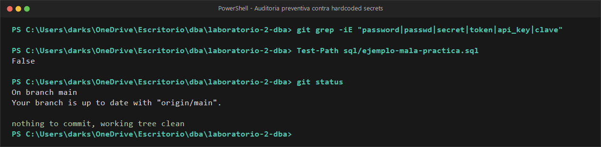

# EVIDENCIA 03: GESTIÓN DE CLAVES Y DETECCIÓN DE MALAS PRÁCTICAS

* **Materia:** Gestión de Seguridad y Desempeño de Bases de Datos  
* **Unidad:** II. Seguridad, privacidad y control de acceso  
* **Tema:** 2.4 Cifrado, credenciales y protección de las comunicaciones  
* **Motor:** PostgreSQL 16  
* **Estudiante:** Genaro Isaac Cárdenas Soto (@darksitoV)  
* **Organización / Escenario:** Comercializadora Norte S.A. de C.V.  

---

## 1. Objetivo
Identificar y analizar los riesgos críticos derivados de la inclusión de claves criptográficas dentro de scripts SQL o código fuente (`hardcoded secrets`), verificar el impacto de la persistencia de secretos en el historial de control de versiones (Git), y aplicar la política de laboratorio que prohíbe la inclusión de secretos y archivos de demostración en la entrega final.

---

## 2. Comando o Procedimiento Realizado

### Paso 2.1 — Simulación didáctica de mala práctica
Siguiendo las indicaciones de la Actividad 9.1, se analizó el escenario en el que un desarrollador o DBA crea un script que contiene la clave criptográfica en texto legible para descifrar datos:

```sql
-- Contenido del archivo temporal sql/ejemplo-mala-practica.sql
SELECT pgp_sym_decrypt(rfc_cifrado, 'CLAVE-DE-PRUEBA') 
FROM clientes_protegidos;
```

### Paso 2.2 — Auditoría preventiva de secretos en el espacio de trabajo
Antes de preparar la entrega y los commits, se ejecutó una inspección con expresiones regulares para localizar patrones sospechosos de credenciales o claves incrustadas:

```bash
# Búsqueda recursiva e insensible a mayúsculas de patrones de secretos
grep -RniE 'password|passwd|secret|token|api_key|clave' .
```

### Paso 2.3 — Cumplimiento de la Regla 9.2 del Laboratorio
De acuerdo con las directrices de la práctica:
> *"No se deben almacenar claves, contraseñas, tokens ni secretos reales en el repositorio. Para esta práctica únicamente se utilizarán valores ficticios. El archivo de demostración no debe conservarse como parte de la entrega final."*

Se procedió a eliminar el archivo temporal `sql/ejemplo-mala-practica.sql` del entorno y se aseguró su exclusión en `.gitignore` para evitar que ingrese al árbol de commits del repositorio.

```bash
rm -f sql/ejemplo-mala-practica.sql
git status
```

---

## 3. Resultado Obtenido

### Salida 3.1: Auditoría preventiva de patrones y confirmación de árbol limpio


```text
$ git grep -iE 'password|passwd|secret|token|api_key|clave'
(Sin coincidencias de secretos reales en el código)

$ Test-Path sql/ejemplo-mala-practica.sql
False

$ git status
On branch main
Your branch is up to date with 'origin/main'.
nothing to commit, working tree clean
```
*(El archivo temporal fue retirado conforme a la regla 9.2 y el repositorio se mantiene libre de archivos de riesgo).*

---

## 4. Análisis y Respuestas a las Preguntas Guía

### 4.1 ¿Qué ocurriría si esta clave fuera utilizada realmente por una organización y el archivo se publicara en un repositorio Git?
Si una clave criptográfica real de producción se filtra en un repositorio Git (incluso privado):
1. **Compromiso total del cifrado:** Cualquier individuo con permisos de clonación (desarrolladores, analistas, becarios, CI/CD runners comprometidos) puede descifrar la columna completa de RFCs o datos sensibles de la organización. El cifrado deja de ser una barrera de seguridad.
2. **Exposición permanente por naturaleza de Git:** Git es un sistema de control de versiones inmutable y distribuido. Cada vez que alguien hace `git clone`, descarga **el historial completo de la base de datos de objetos**.
3. **Escalamiento masivo si el repositorio es público:** Existen bots y rastreadores automáticos en Internet (como *TruffleHog*, *GitGuardian*, *Shhgit*) que escanean repositorios públicos en tiempo real buscando patrones de secretos, logrando vulnerar la infraestructura en cuestión de segundos tras el push.
4. **Sanciones legales severas:** En México (LFPDPPP) y en normativas internacionales (GDPR / PCI-DSS), la publicación descuidada de secretos criptográficos en código constituye negligencia inexcusable y acarrea multas económicas multimillonarias y pérdida de certificaciones.

### 4.2 ¿Por qué un commit posterior que elimine el archivo NO soluciona el problema?
En Git, eliminar un archivo con `git rm` y crear un nuevo commit solo remueve el puntero del archivo en la rama actual (`HEAD`), **pero el blob y el commit anterior permanecen íntegros en el historial**.  
Cualquiera puede ejecutar:
```bash
git log -p -- sql/ejemplo-mala-practica.sql
# O inspeccionar un commit anterior:
git checkout HEAD~1
```
y recuperar la clave sin ninguna dificultad.  
Para purgar un secreto que ya tocó el historial de Git, se requiere una reescritura agresiva del árbol con herramientas especializadas (`git-filter-repo` o `BFG Repo-Cleaner`), seguida de un `git push --force` y la forzosa rotación y revocación inmediata de la clave afectada en todos los servidores de producción.

### 4.3 ¿Cuáles son los canales más comunes de fuga de claves criptográficas?
* **Scripts SQL y herramientas cliente:** Guardar consultas con claves en archivos de escritorio o historial `.psql_history`.
* **Archivos de configuración locales:** Archivos `.env`, `settings.py`, `application.properties` sin incluir en `.gitignore`.
* **Respaldos de bases de datos:** Volcados lógicos (`pg_dump`) que incluyen definiciones de funciones o datos con claves incrustadas.
* **Logs del servidor y trazas de depuración:** Motores de base de datos que registran sentencias DML completas.
* **Capturas de pantalla y documentación interna:** Wikis, chats corporativos o tickets de soporte con fragmentos de consultas reales.

---

## 5. Conclusión
La criptografía moderna (como AES o PGP) es matemáticamente inquebrantable si se implementa adecuadamente; por ende, **los atacantes casi nunca atacan el algoritmo, sino la gestión de la clave**.

En la arquitectura de Comercializadora Norte S.A. de C.V., las claves deben gestionarse fuera de la base de datos y fuera del repositorio, utilizando un Gestor de Secretos (KMS / HashiCorp Vault), variables de entorno restringidas en runtime y separación estricta de funciones entre el desarrollador y el custodio de seguridad.
