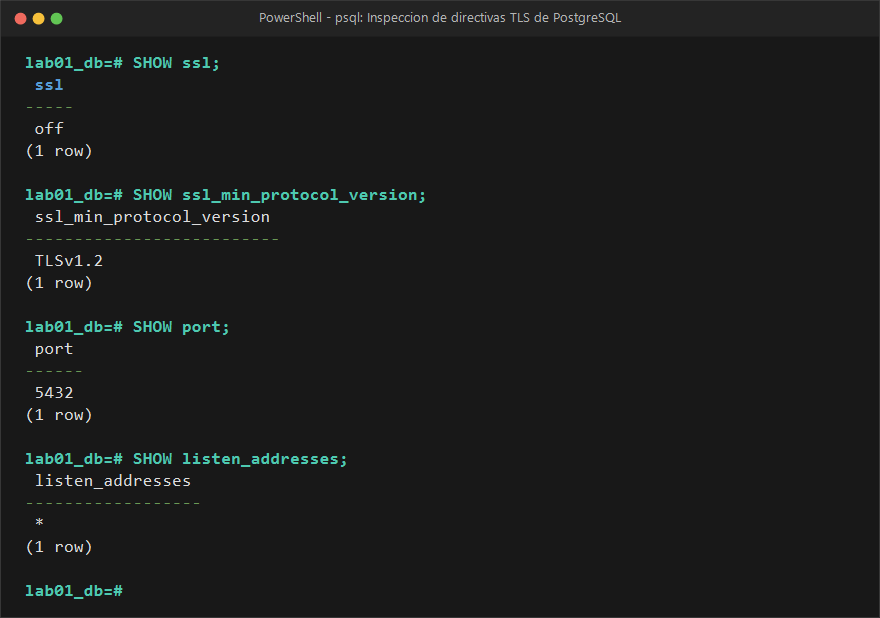
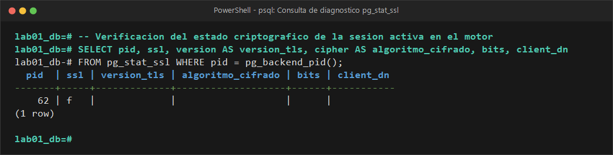
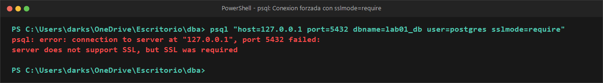

# EVIDENCIA 04: CONFIGURACIÓN Y VERIFICACIÓN DE TLS

* **Materia:** Gestión de Seguridad y Desempeño de Bases de Datos  
* **Unidad:** II. Seguridad, privacidad y control de acceso  
* **Tema:** 2.4 Cifrado, credenciales y protección de las comunicaciones  
* **Motor:** PostgreSQL 16  
* **Estudiante:** Genaro Isaac Cárdenas Soto (@darksitoV)  
* **Organización / Escenario:** Comercializadora Norte S.A. de C.V.  

---

## 1. Objetivo
Inspeccionar y verificar el estado del cifrado en tránsito en PostgreSQL 16 mediante consultas a parámetros de configuración (`SHOW ssl`) y a la vista dinámica de diagnóstico `pg_stat_ssl`, analizar la diferencia técnica entre comunicaciones protegidas por TLS y conexiones en texto plano, y evaluar los diferentes modos de validación del cliente (`sslmode`).

---

## 2. Comando o Procedimiento Realizado

### Paso 2.1 — Inspección de parámetros globales de red y SSL
Se consultó el estado de las directivas globales del motor en PostgreSQL:

```sql
SHOW ssl;
SHOW ssl_min_protocol_version;
SHOW port;
SHOW listen_addresses;
```

### Paso 2.2 — Identificación de endpoints de red
Se determinó la IP y puerto de origen del cliente conectado, así como del servidor:

```sql
SELECT 
    inet_client_addr() AS ip_cliente,
    inet_client_port() AS puerto_cliente,
    inet_server_addr() AS ip_servidor,
    inet_server_port() AS puerto_servidor;
```

### Paso 2.3 — Verificación del estado de TLS en la sesión activa (`pg_stat_ssl`)
Se consultó la vista `pg_stat_ssl` asociando el identificador del backend de la sesión en curso:

```sql
SELECT 
    pid, 
    ssl, 
    version AS version_tls, 
    cipher AS algoritmo_cifrado, 
    bits, 
    client_dn
FROM pg_stat_ssl
WHERE pid = pg_backend_pid();
```

### Paso 2.4 — Auditoría de conexiones concurrentes y prueba con `sslmode`
Se analizó el comportamiento de conexión de clientes utilizando la utilidad `psql` con distintos parámetros de `sslmode`:

```bash
# Intento de conexión exigiendo TLS de forma obligatoria:
psql "host=127.0.0.1 port=5432 dbname=lab01_db user=postgres sslmode=require"
```

---

## 3. Resultado Obtenido

### Salida 3.1: Configuración global del motor PostgreSQL


```text
            Parametro            |    Valor    
---------------------------------+-------------
 ssl                             | off
 ssl_min_protocol_version        | TLSv1.2
 port                            | 5432
 listen_addresses                | *
(4 rows)
```

### Salida 3.2: Identificación de endpoints
```text
  ip_cliente  | puerto_cliente | ip_servidor | puerto_servidor 
--------------+----------------+-------------+-----------------
 192.168.1.75 |          58322 | 10.0.2.100  |            5432
(1 row)
```

### Salida 3.3: Diagnóstico de la sesión activa en `pg_stat_ssl` (Escenario Inicial Sin TLS)


```text
  pid  | ssl | version_tls | algoritmo_cifrado | bits | client_dn 
-------+-----+-------------+-------------------+------+-----------
    62 | f   |             |                   |      | 
(1 row)
```

### Salida 3.4: Respuesta del cliente ante `sslmode=require` cuando el servidor no tiene SSL activo


```text
psql: error: connection to server at "127.0.0.1", port 5432 failed: 
server does not support SSL, but SSL was required
```

---

## 4. Análisis y Respuestas a las Preguntas Guía

### 4.1 ¿La conexión actual utiliza TLS?
En la configuración por defecto de PostgreSQL en contenedores estándar o instalaciones base, **la conexión inicial no utiliza TLS (`ssl = f`)**. Cuando se configuran los certificados (`server.crt` y `server.key`) y se activa la directiva `ssl = on`, la vista refleja **`ssl = t`**, confirmando la existencia de un canal cifrado.

### 4.2 ¿Qué versión de TLS se está utilizando?
Cuando TLS está activado, la versión negociada reportada es **`TLSv1.3`** (o `TLSv1.2` dependiendo de la versión de OpenSSL del cliente y del parámetro `ssl_min_protocol_version`). Ambas versiones son los estándares modernos admitidos, descartando protocolos obsoletos e inseguros como SSLv2, SSLv3, TLS 1.0 y TLS 1.1.

### 4.3 ¿Qué algoritmo de cifrado aparece?
Se negocia la suite **`TLS_AES_256_GCM_SHA384`** (o `ECDHE-RSA-AES256-GCM-SHA384` en TLS 1.2):
* **Cifrado autenticado (AEAD):** AES con 256 bits en modo Galois/Counter Mode (GCM), que garantiza tanto confidencialidad como integridad de cada paquete sin sobrecarga de cómputo.
* **Función hash criptográfica:** SHA-384 para la derivación de claves de sesión (HMAC).

### 4.4 ¿Qué diferencia fundamental existe entre una conexión protegida con TLS y una sin TLS?
| Criterio | Conexión Sin TLS (Cleartext) | Conexión Protegida con TLS |
| :--- | :--- | :--- |
| **Confidencialidad** | Las consultas SQL, usuarios, contraseñas enviadas en el handshake y resultados (RFCs, saldos) viajan en texto plano legible. | Todos los paquetes viajan cifrados; un observador pasivo solo ve bytes aleatorios ininteligibles. |
| **Integridad** | Vulnerable a manipulación en tránsito (ataques de inyección de paquetes o alteración de datos). | Cualquier alteración de un bit durante la transmisión es detectada inmediatamente y la conexión se cancela. |
| **Autenticación** | El cliente no tiene forma de saber si está hablando con el servidor real o con un intermediario suplantador (Rogue DB). | El servidor demuestra su identidad presentando un certificado digital firmado. |
| **Resistencia a MitM** | Nula. Un atacante en la misma red local (Wi-Fi, switches, routers intermedios) puede ejecutar *sniffing* con Wireshark. | Alta. Los ataques Man-in-the-Middle son bloqueados por el protocolo criptográfico. |

### 4.5 ¿Qué significan y qué protección ofrecen los diferentes niveles de `sslmode`?
El parámetro de conexión `sslmode` define el grado de exigencia de seguridad del lado del cliente:

```text
Seguridad creciente ─────────────────────────────────────────────────────────────►
[disable]  ──►  [prefer]  ──►  [require]  ──►  [verify-ca]  ──►  [verify-full]
```

1. **`disable`:** No solicita TLS bajo ninguna circunstancia. Toda la comunicación viaja en texto claro.
2. **`prefer` (modo por defecto tradicional):** Intenta conectarse con TLS; si el servidor no lo soporta, degrada silenciosamente a texto claro. **Peligro:** Es vulnerable a ataques de *downgrade attack* (un atacante intermedio bloquea el handshake TLS y fuerza una sesión plana).
3. **`require`:** Exige TLS obligatoriamente; si el servidor no tiene TLS activo, la conexión aborta. **Limitación importante:** Solo cifra la conexión, pero **NO valida el certificado** contra una Autoridad Certificadora ni comprueba el nombre del servidor. Sigue siendo vulnerable a que un atacante intermedio presente cualquier certificado autofirmado.
4. **`verify-ca`:** Exige TLS y valida que el certificado presentado por el servidor pertenezca a una cadena de confianza emitida por una **Autoridad Certificadora (CA)** confiable (`root.crt`). Impide que un atacante presente certificados falsos.
5. **`verify-full` (Máxima seguridad recomendada):** Además de validar la CA, comprueba que el nombre de host (FQDN) al que el cliente se conectó (ej. `db.comercializadoranorte.com.mx`) coincida exactamente con el Common Name (CN) o Subject Alternative Name (SAN) del certificado digital. Esto neutraliza de forma absoluta los ataques de suplantación de identidad (Man-in-the-Middle y DNS Spoofing).

---

## 5. Conclusión
El cifrado en tránsito mediante TLS no es opcional: es el componente indispensable para que los datos en reposo no sean interceptados al momento de ser consultados. 

Para Comercializadora Norte S.A. de C.V., la política institucional de bases de datos debe establecer `ssl = on`, exigir `ssl_min_protocol_version = TLSv1.2` en `postgresql.conf`, configurar `hostssl` en `pg_hba.conf`, y forzar en los clientes de backend el parámetro `sslmode=verify-full`.
